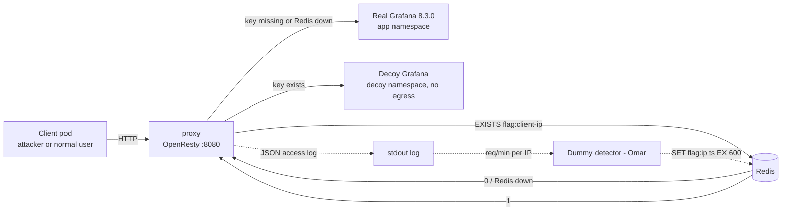

# Routing rule design — 2026-11-22 (owner: Seif)

## 1. Request flow

Step by step:
1. Every request enters through the proxy (the only entry point).
2. Proxy reads the client IP from the TCP connection (`$remote_addr`).
3. Proxy asks Redis: does `flag:<ip>` exist? (100 ms timeout)
4. Exists -> forward to the decoy. Missing, error or timeout -> forward to the real Grafana.
5. Proxy writes a JSON log line with `route` = `grafana_real` or `grafana_decoy`.
6. Detector reads the log, counts requests/min per IP, and writes `flag:<ip>` when over N.
7. Next request from that IP goes to the decoy. After the TTL ends with no new detection, it goes back to real.

## 2. The rules
| # | Rule | Why |
|---|---|---|
| R1 | The proxy is the **only** way in. Real Grafana has a ClusterIP Service only (no NodePort/LoadBalancer/port-forward in the demo). | Otherwise the attacker skips the proxy and the whole loop. |
| R2 | Client identity = `$remote_addr` only. **Never** trust `X-Forwarded-For`. | An attacker can write any IP in that header and escape the flag. |
| R3 | Flag key exists => decoy for **all** requests from that IP until the key expires. | The attacker sees one consistent system; every request after the flag is captured on the decoy. |
| R4 | Redis down or slow (>100 ms) => real Grafana (**fail-open**). | Gate requires normal users unaffected. Re-evaluate after the gate. |
| R5 | Detector **refreshes** the TTL each time it detects the IP again (it sees decoy traffic in the same log). | An active attacker stays in the decoy; a quiet IP comes back after 10 min. |
| R6 | Never flag the IPs of the proxy, detector, Redis or Prometheus/monitoring pods. | Flagging internal components would break the system. |
| R7 | Attacker script and Locust run as **pods inside the cluster**. | Traffic from the laptop through the k3d load balancer is SNAT'ed, so both would share one IP. |

## 3. Flag contract (agree with Omar)
| Item | Value |
|---|---|
| Key | `flag:<ipv4>` e.g. `flag:10.42.0.17` |
| Value | Unix timestamp of the detection (proxy ignores it; we use it to measure time-to-divert for the paper) |
| Write | `SET flag:<ip> <unix-ts> EX 600` |
| TTL | 600 s (10 min) — keep it a config variable |
| Manual unflag | `DEL flag:<ip>` |
| Manual test | `SET flag:<ip> test EX 60` |

## 4. Addresses (proposed — confirm with Sohaib and Tarek)
| Component | Namespace | Service:port | Full DNS name | Owner |
|---|---|---|---|---|
| Real Grafana | `app` | `grafana:3000` | `grafana.app.svc.cluster.local` | Sohaib |
| Decoy Grafana | `decoy` | `grafana-decoy:3000` | `grafana-decoy.decoy.svc.cluster.local` | Tarek |
| Proxy | `net` | `proxy:80` -> 8080 | `proxy.net.svc.cluster.local` | el-Tanikhy |
| Redis | `net` | `redis:6379` | `redis.net.svc.cluster.local` | el-Tanikhy |
| Attacker + Locust pods | `clients` | — | target `http://proxy.net.svc.cluster.local/` | Sohaib |

Decoy NetworkPolicy (Tarek): allow ingress **only** from pods in `net` with label `app=proxy`; deny all egress.
